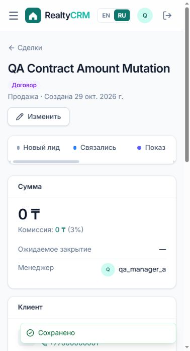

# BUG-001

На этапе «Договор» можно сохранить нулевую сумму сделки

**Severity:** Major · **Priority:** P1 · **Status на проверенной ревизии:** Open

Ревизия: `b2c941a2843c90a5f4216fd4fffc6b4dfd8b3605`. Среда: изолированная SQLite, DEMO_MODE=False, синтетические пользователи.

## Предусловия

Менеджер A; своя сделка с объектом sale, amount=50000000, stage=contract.

## Шаги

1. Создать сделку с доступным объектом и положительной суммой.
2. Перевести сделку на этап «Договор».
3. Открыть «Изменить» и заменить сумму на 0.
4. Сохранить и проверить этап, сумму и комиссию.

## API

PATCH /api/deals/{id}/  JSON: {"amount": 0}

## Ожидаемый результат

HTTP 400 с ошибкой суммы. На этапе договора amount должен оставаться больше нуля; прежняя сумма сохраняется.

## Фактический результат

HTTP 200, stage=contract, amount=0, commission=0. В интерфейсе показано «Сохранено», этап остаётся «Договор».

## Влияние

Недопустимое состояние договора и нулевая комиссия искажают данные воронки и финансовую аналитику.

## Основание

Правило проверяется в services.move_deal, но отсутствует в DealSerializer.validate при PATCH. README: договор требует суммы.

## Рекомендация

Проверять положительную сумму для результирующего состояния contract/won при каждом изменении сделки.

## Повторная проверка

Повторить PATCH и UI-сценарий с 0. Проверить, что API отклоняет изменение, а положительная сумма сохраняется; отдельно проверить границу amount=1 через API.

## Доказательства

- [evidence/TC-024.json](../evidence/TC-024.json)
- [evidence/BUG-001-contract-zero.png](../evidence/BUG-001-contract-zero.png)

Связанные кейсы: TC-024, TC-045. Правила: REQ-08.
