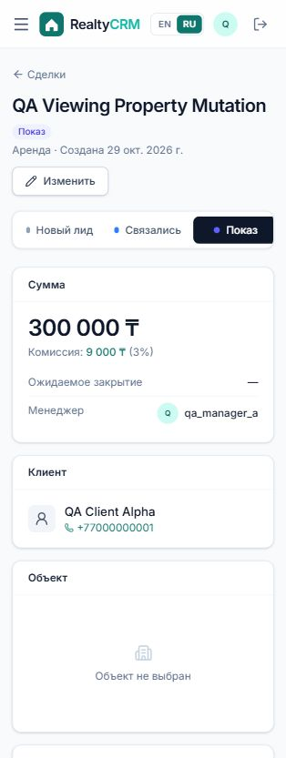

# BUG-002

На этапе «Показ» можно удалить привязанный объект

**Severity:** Major · **Priority:** P1 · **Status на проверенной ревизии:** Open

Ревизия: `b2c941a2843c90a5f4216fd4fffc6b4dfd8b3605`. Среда: изолированная SQLite, DEMO_MODE=False, синтетические пользователи.

## Предусловия

Менеджер A; своя сделка с объектом, stage=viewing.

## Шаги

1. Создать свою сделку с объектом.
2. Перевести на этап «Показ».
3. Открыть «Изменить» и выбрать «Объект не выбран».
4. Сохранить и проверить этап и привязанный объект.

## API

PATCH /api/deals/{id}/  JSON: {"property": null}

## Ожидаемый результат

HTTP 400 с ошибкой привязки. Пока сделка на этапе viewing/negotiation, объект должен сохраняться.

## Фактический результат

HTTP 200, stage=viewing, property=null. В интерфейсе этап «Показ» сочетается с «Объект не выбран».

## Влияние

Сделка остаётся на рабочем этапе без объекта; показы и дальнейшие действия опираются на неполные данные.

## Основание

STAGES_NEEDING_PROPERTY проверяется в services.move_deal. DealSerializer.validate блокирует замену только для contract/won.

## Рекомендация

Проверять наличие объекта по итоговому этапу сделки при PATCH, а не только при смене этапа.

## Повторная проверка

Повторить удаление объекта на viewing и negotiation; проверить отказ и сохранение старой привязки. На new/contacted отвязка должна оставаться допустимой.

## Доказательства

- [evidence/TC-025.json](../evidence/TC-025.json)
- [evidence/BUG-002-context.png](../evidence/BUG-002-context.png)
- [evidence/BUG-002-full-page.png](../evidence/BUG-002-full-page.png)

Связанные кейсы: TC-025, TC-046. Правила: REQ-07.
