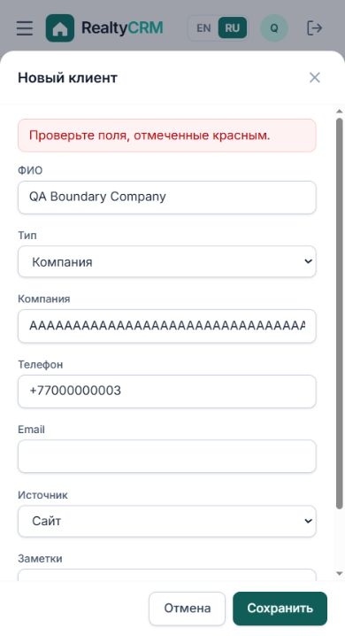

# BUG-003

Ошибка длины названия компании не отображается у поля

**Severity:** Minor · **Priority:** P2 · **Status на проверенной ревизии:** Open

Ревизия: `b2c941a2843c90a5f4216fd4fffc6b4dfd8b3605`. Среда: изолированная SQLite, DEMO_MODE=False, синтетические пользователи.

## Предусловия

Менеджер A; язык RU; форма «Новый клиент», тип «Компания». Максимум company_name — 150 символов.

## Шаги

1. Указать корректные ФИО и телефон.
2. Выбрать тип «Компания».
3. Ввести 151 букву A в поле «Компания».
4. Нажать «Сохранить» и проверить сообщение у поля.

## API

POST /api/clients/  company_name="A" × 151, kind="company"

## Ожидаемый результат

Сервер возвращает 400, а интерфейс показывает понятное сообщение у поля «Компания» и выделяет ошибочное поле.

## Фактический результат

API возвращает ошибку company_name. UI показывает только «Проверьте поля, отмеченные красным»; поле без ошибки и красной рамки. Повторено дважды.

## Влияние

Пользователь не видит причину отказа и не понимает, какое поле нужно исправить.

## Основание

ClientForm передаёт error для name/phone/email, но не передаёт errors.field("company_name") для поля компании.

## Рекомендация

Передавать ошибку company_name в компонент Input; при необходимости добавить maxLength и понятный текст ограничения.

## Повторная проверка

Проверить 150 и 151 символ: 150 сохраняется, 151 даёт видимую ошибку у правильного поля. Исправление значения должно позволять сохранение.

## Доказательства

- [evidence/TC-015.json](../evidence/TC-015.json)
- [evidence/TC-044-ui.txt](../evidence/TC-044-ui.txt)
- [evidence/BUG-003-company-validation.png](../evidence/BUG-003-company-validation.png)
- [evidence/BUG-003-repeat.png](../evidence/BUG-003-repeat.png)

Связанные кейсы: TC-015, TC-044. Правила: REQ-05, REQ-14.
